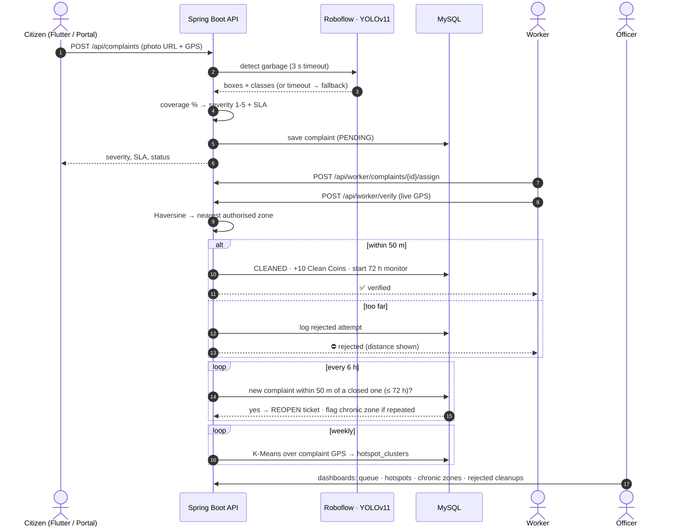
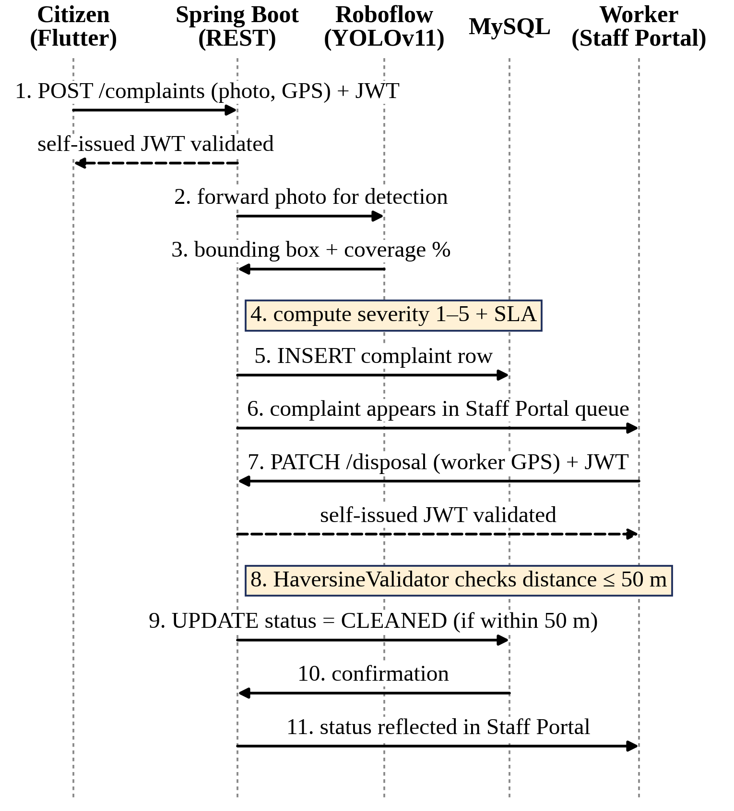
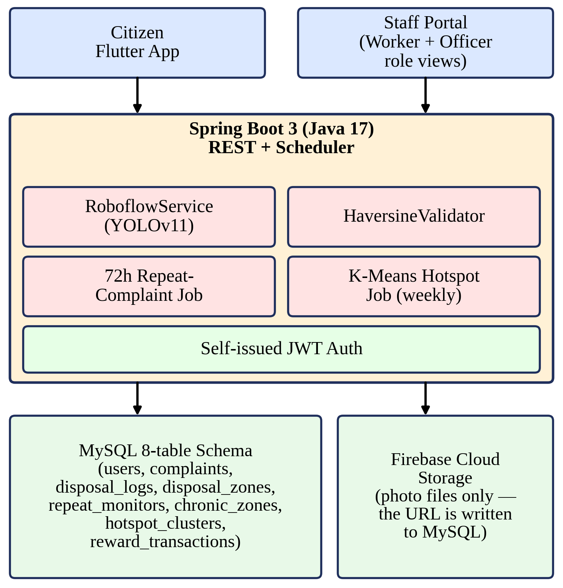
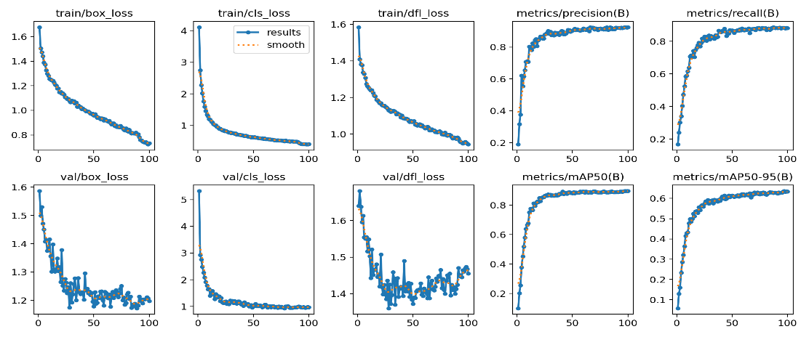
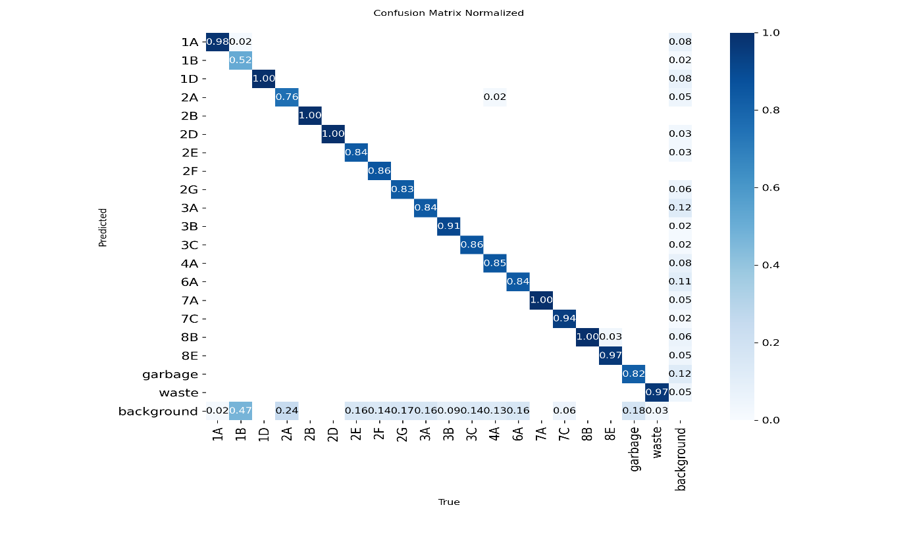

<div align="center">

# 🌿 SwachhDrishti

### AI-powered garbage severity scoring & GPS-verified cleanup accountability for Indian cities

*Citizens photograph it. YOLOv11 measures it. GPS proves it was cleaned. K-Means predicts where it comes back.*

<br>


**Final-year project · Department of Information Technology · 2026**

[Quick start](#-quick-start) · [How it works](#-how-it-works) · [Citizen app](#-citizen-app-flutter) · [Staff Portal](#-staff-portal) · [API](#-api-reference) · [Research paper](docs/SwachhDrishti_IEEE_Paper.docx)

</div>

---

## 📑 Table of contents

- [The problem](#-the-problem)
- [What makes SwachhDrishti different](#-what-makes-swachhdrishti-different)
- [How it works](#-how-it-works)
- [Architecture](#-architecture)
- [Quick start](#-quick-start)
- [Citizen app (Flutter)](#-citizen-app-flutter)
- [Staff Portal](#-staff-portal)
- [Configuration](#-configuration)
- [API reference](#-api-reference)
- [Try the whole flow with curl](#-try-the-whole-flow-with-curl)
- [AI model & results](#-ai-model--results)
- [Project structure](#-project-structure)
- [Testing](#-testing)
- [Security notes](#-security-notes)
- [Project status & roadmap](#-project-status--roadmap)
- [Team](#-team)

---

## 🗑️ The problem

India generates roughly **62 million tonnes** of municipal solid waste every year and **under 20 %** of it is scientifically processed. The rest ends up on streets, vacant plots and drains. Existing grievance apps and smart-bin sensors only solve a slice of this:

| Gap | What goes wrong today | SwachhDrishti's answer |
|---|---|---|
| **Severity** | A stray polythene bag and a truckload of debris queue with equal priority | YOLOv11 bounding-box coverage → **5-level severity + SLA deadline** |
| **Coverage** | IoT sensors only watch fixed bins, not open pavements or plots | The **citizen's phone is the sensor** – any location works |
| **Accountability** | Workers self-report "resolved" with zero proof | **GPS geofence**: "cleaned" only accepted within **50 m** of an authorised disposal zone, checked on the server |
| **Reactive** | Hotspots flagged only once they're huge | **K-Means** over complaint history predicts hotspots early |
| **Tick-box closure** | Officers close tickets to hit targets | **72-hour repeat trap** auto-reopens a ticket if a new complaint appears nearby |

---

## ✨ What makes SwachhDrishti different

<table>
<tr>
<td width="50%" valign="top">

### 📸 Severity from a photo
Detected garbage regions become a **coverage %** (overlapping boxes counted once), mapped to severity 1-5 with an SLA from 48 h down to *immediate dispatch*.

### 📍 Server-side geofence
The worker's GPS is sent to the backend, which computes the **Haversine distance** to the nearest authorised zone. The client can't change the verdict, and *rejected attempts are logged too*.

</td>
<td width="50%" valign="top">

### 🕵️ 72-hour fraud trap
Every verified cleanup is watched for 72 h. A new complaint within 50 m **reopens the ticket** and floats it to the top of the officer queue. Repeat offenders become **chronic zones**.

### 🔮 Hotspot prediction
A from-scratch **K-Means** (no ML library) runs weekly and publishes cluster centres with LOW → CRITICAL risk, so trucks can be pre-positioned.

</td>
</tr>
<tr>
<td colspan="2">

### 🪙 Clean Coins
Citizens earn coins when *their* report is genuinely verified as cleaned – paid **once per complaint**, never twice, even if the ticket is reopened and cleaned again.

</td>
</tr>
</table>

### Severity & SLA table

| Level | Garbage coverage of the photo | SLA to clean |
|:-:|:-:|:-:|
| 🟢 **1** | < 5 % | 48 h |
| 🟡 **2** | 5 – 15 % | 24 h |
| 🟠 **3** | 15 – 35 % | 12 h |
| 🔴 **4** | 35 – 60 % | 6 h |
| 🟣 **5** | > 60 % | Immediate dispatch |

> If the AI is slow (> 3 s), down, or not confident (detections below confidence **0.495**), the complaint is **never blocked**: it falls back to *Mixed / severity 3* and is flagged **needs review** for a human.

---

## 🔄 How it works



<details>
<summary><b>Paper figure – API sequence (click to expand)</b></summary>
<br>

</details>

---

## 🏗️ Architecture

A three-tier design where **one backend is the only writer** to the database, giving a single auditable trail for both citizen-facing and staff-facing surfaces.

<div align="center">

</div>

| Tier | Technology | Role |
|---|---|---|
| **Presentation** | Flutter app (citizens) · single-file HTML/JS **Staff Portal** (workers + officers) | Capture, track, dispatch, review |
| **Application** | Spring Boot 3 · Java 17 | REST API, JWT auth, Roboflow client, Haversine, two scheduled jobs, K-Means |
| **Persistence** | MySQL 8 (8 tables) · Firebase Cloud Storage for photo files | State + evidence trail; only the photo URL is stored in SQL |

<details>
<summary><b>The 8-table schema</b></summary>

| Table | Purpose |
|---|---|
| `users` | name, e-mail, role (`CITIZEN`/`WORKER`/`OFFICER`), Clean Coins, report count |
| `complaints` | photo URL, GPS, garbage type, severity 1-5, coverage %, SLA, status, assigned worker, `needs_review` |
| `disposal_zones` | authorised landfill / transfer-station coordinates + radius |
| `disposal_logs` | every cleanup attempt with worker GPS and authorised / rejected flag |
| `repeat_monitors` | one 72-hour watch per closed complaint |
| `chronic_zones` | spots that keep re-offending after cleanup |
| `hotspot_clusters` | weekly K-Means output: centre, size, risk level |
| `reward_transactions` | every Clean Coin ever granted |

Complaint lifecycle: `PENDING → ASSIGNED → CLEANED → (REOPENED → ASSIGNED → CLEANED …)`

</details>

---

## 🚀 Quick start

> 📘 **Setting this up on a new PC?** Follow the step-by-step **[Setup Guide](docs/SETUP_GUIDE.md)** (installs, commands, logins, troubleshooting).

**Prerequisites:** JDK 17+ and Maven 3.9+. (MySQL or Docker only for the options below that use them.)

### Option A — 2-minute start (no database needed) ⭐

```powershell
git clone https://github.com/awaneetdecoder/AKGEC_FinalYear_2026.git
cd AKGEC_FinalYear_2026/swachhdrishti-backend
mvn spring-boot:run "-Dspring-boot.run.profiles=h2"
```

Open **http://localhost:8080** and click **Create account**. Everyone signs up themselves and later signs in with the same e-mail and password:

| Role | Sign-up needs |
|---|---|
| Citizen | name, e-mail, password |
| Worker / Officer | the above **plus the staff registration code**. With the `h2` profile the code is `swachh-staff-2026` (override with `STAFF_ACCESS_CODE`) |

> The `h2` profile uses an in-memory database that resets on every restart, and supplies local-only defaults for `JWT_SECRET` and `STAFF_ACCESS_CODE`. AI detection uses the offline stand-in unless you configure Roboflow. Want placeholder complaints so the hotspot view has data? Set `SEED_SAMPLE_DATA=true` first (test data, off by default).

### Option B — MySQL

```bash
# 1. start MySQL 8 (or use your own) and set credentials – never commit them
export DB_PASSWORD='your-mysql-password'
export JWT_SECRET="$(openssl rand -base64 48)"
export STAFF_ACCESS_CODE='choose-a-code'

# 2. run (the 'swachhdrishti' database is created automatically)
cd swachhdrishti-backend
mvn spring-boot:run
```

### Option C — Docker Compose (MySQL + backend)

```bash
cp .env.example .env        # then edit: DB_ROOT_PASSWORD, JWT_SECRET, STAFF_ACCESS_CODE
docker compose up --build
```

### Switching on the real YOLOv11 model

```bash
export ROBOFLOW_MOCK=false
export ROBOFLOW_API_KEY='…'
export ROBOFLOW_MODEL_URL='https://detect.roboflow.com/<your-project>/<version>'
```

The backend calls the Roboflow hosted-detection API, drops detections below **0.495** confidence, merges overlapping boxes, and uses the union area ÷ image area as coverage.

---

## 📱 Citizen app (Flutter)

Source in [`swachhdrishti-app/`](swachhdrishti-app/). Capture a photo → live GPS tag → submit → see **severity, coverage and target cleanup time** → track status → earn 🪙 Clean Coins. It rejects mock/simulated GPS on Android.

```bash
cd swachhdrishti-app
flutter create . --project-name swachhdrishti_app   # generates android/ + ios/
flutter pub get
# add camera/location permissions - see swachhdrishti-app/README.md
flutter run                                         # USB phone: first run  adb reverse tcp:8080 tcp:8080
```

Full setup, permissions and the phone-on-Wi-Fi instructions are in [`swachhdrishti-app/README.md`](swachhdrishti-app/README.md).

---

## 🖥️ Staff Portal

Served by Spring Boot at **`/`** – one dependency-free HTML/CSS/JS file, no Node server, light & dark mode, mobile-friendly.

| Role | What you get |
|---|---|
| 🧑 **Citizen** *(web version of the mobile app)* | Report garbage (camera/photo + GPS), see severity/SLA instantly, track your reports and 🪙 Clean Coins |
| 🧹 **Worker** | Severity-ranked job queue, **Claim** a job, **Mark cleaned** with live GPS → server geofence verdict with distance |
| 🏛️ **Officer** | Live counters, priority queue (reopened tickets first), **K-Means hotspots**, **chronic zones**, **cleanup log** incl. rejected attempts, buttons to run the 72-h check / hotspot job on demand |

Hosting the portal elsewhere? Open `index.html?api=https://your-server:8080` and set `CORS_ORIGINS`.

---

## ⚙️ Configuration

Everything is overridable by environment variable – **no secrets live in Git**. See [`application.properties`](swachhdrishti-backend/src/main/resources/application.properties) and [`.env.example`](.env.example).

| Variable | Default | Meaning |
|---|---|---|
| `DB_URL` / `DB_USERNAME` / `DB_PASSWORD` | local MySQL / `root` / *(empty)* | Database connection |
| `JWT_SECRET` | *(none)* | **Required**, ≥ 32 chars (the app refuses to start otherwise). The `h2` profile provides a local-only default |
| `JWT_EXPIRY_HOURS` | `24` | Token lifetime |
| `STAFF_ACCESS_CODE` | *(empty)* | Registration code for WORKER / OFFICER sign-up. Empty = staff registration closed |
| `ROBOFLOW_MOCK` | `true` | `false` to call the real model |
| `ROBOFLOW_API_KEY`, `ROBOFLOW_MODEL_URL` | – | Your hosted model |
| `ROBOFLOW_TIMEOUT_MS` | `3000` | Per-phase timeout before the fallback kicks in |
| `ROBOFLOW_CONFIDENCE` | `0.495` | Minimum detection confidence (F1-optimal on the validation set) |
| `CORS_ORIGINS` | `*` | Comma-separated allowed browser origins for `/api/**` |
| `UPLOAD_DIR` | `uploads` | Where uploaded photos are stored on disk |
| `SEED_SAMPLE_DATA` | `false` | Adds ~40 placeholder complaints for the hotspot view. Test data only |

Job tuning (in `application.properties`): `app.repeat-monitor.{window-hours,radius-meters,interval-ms,chronic-threshold}`, `app.hotspot.{k,min-complaints,interval-ms}`.

---

## 📡 API reference

All `/api/**` endpoints except sign-in and sign-up need `Authorization: Bearer <token>`. Errors are always `{"status": 4xx, "message": "…"}`.

| Method | Endpoint | Role | Description |
|---|---|---|---|
| `POST` | `/api/auth/register` | public | Create an account → JWT. Body: `name`, `email`, `password` (≥ 8), `role`, `accessCode` *(staff only)* |
| `POST` | `/api/auth/login` | public | Sign in with `email` + `password` → JWT (role comes from the account) |
| `GET` | `/api/auth/me` | any | Profile, Clean Coins, report count |
| `POST` | `/api/uploads` | CITIZEN | Multipart photo upload (`file`) → `{url}` to use in the complaint |
| `POST` | `/api/complaints` | CITIZEN | Submit `{photoUrl, latitude, longitude}` → AI + severity pipeline (`201`) |
| `GET` | `/api/complaints/mine` | CITIZEN | My reports |
| `GET` | `/api/complaints?status=` | WORKER, OFFICER | Priority queue (reopened → severity → age) |
| `GET` | `/api/complaints/{id}` | any* | One complaint (*citizens: own only) |
| `GET` | `/api/zones` | WORKER, OFFICER | Authorised disposal zones |
| `POST` | `/api/worker/complaints/{id}/assign` | WORKER | Claim a job |
| `POST` | `/api/worker/verify` | WORKER | `{complaintId, workerLatitude, workerLongitude}` → geofence verdict |
| `GET` | `/api/officer/stats` | OFFICER | Dashboard counters |
| `GET` | `/api/officer/hotspots` | OFFICER | K-Means clusters + risk level |
| `GET` | `/api/officer/chronic-zones` | OFFICER | Repeat-offence locations |
| `GET` | `/api/officer/disposal-logs?authorised=false` | OFFICER | Cleanup attempts (filter for rejected) |
| `POST` | `/api/officer/repeat-monitor/run` | OFFICER | Run the 72-hour check now |
| `POST` | `/api/officer/hotspots/refresh` | OFFICER | Recompute hotspots now |
| `GET` | `/actuator/health` | public | Health probe |

---

## 🧪 Try the whole flow with curl

With the server running (`mvn spring-boot:run "-Dspring-boot.run.profiles=h2"`):

```bash
H='Content-Type: application/json'; API=http://localhost:8080/api

# 1. create a citizen and a worker account (staff need the registration code)
CIT=$(curl -s $API/auth/register -H "$H" -d '{"name":"Asha","email":"asha@example.com","password":"Str0ng-pass-1","role":"CITIZEN"}' | jq -r .token)
WRK=$(curl -s $API/auth/register -H "$H" -d '{"name":"Ravi","email":"ravi@example.com","password":"Str0ng-pass-2","role":"WORKER","accessCode":"swachh-staff-2026"}' | jq -r .token)
# (later: sign in with the same details)  curl -s $API/auth/login -H "$H" -d '{"email":"asha@example.com","password":"Str0ng-pass-1"}'

# 2. citizen reports garbage
ID=$(curl -s $API/complaints -H "$H" -H "Authorization: Bearer $CIT" \
  -d '{"photoUrl":"https://example.com/dump.jpg","latitude":28.5,"longitude":77.2}' | tee /dev/stderr | jq -r .complaintId)

# 3. worker claims it, then tries to confirm from far away  → rejected
curl -s -X POST $API/worker/complaints/$ID/assign -H "Authorization: Bearer $WRK" >/dev/null
curl -s $API/worker/verify -H "$H" -H "Authorization: Bearer $WRK" \
  -d "{\"complaintId\":$ID,\"workerLatitude\":28.70,\"workerLongitude\":77.50}"

# 4. …and from 20 m inside the Sector 12 Landfill zone  → verified, citizen earns 10 coins
curl -s $API/worker/verify -H "$H" -H "Authorization: Bearer $WRK" \
  -d "{\"complaintId\":$ID,\"workerLatitude\":28.6694,\"workerLongitude\":77.4538}"
curl -s $API/auth/me -H "Authorization: Bearer $CIT"
```

---

## 🤖 AI model & results

YOLOv11 trained for **100 epochs** on a custom **20-class waste dataset** (1,200 train / 200 val images) built on the [TACO](https://arxiv.org/abs/2003.06975) taxonomy plus two generic classes (`garbage`, `waste`).

| Metric | Value |
|---|---|
| Precision | **92.25 %** |
| Recall | **88.33 %** |
| mAP@0.5 | **89.54 %** |
| mAP@0.5:0.95 | 63.49 % |
| F1 | 0.90 at confidence 0.495 |
| Inference budget | < 3 s per image |

<table>
<tr>
<td align="center"><b>Training & validation curves</b><br></td>
<td align="center"><b>Normalised confusion matrix</b><br></td>
</tr>
</table>

Weakest class is **1B (cigarette packaging, recall 0.52)** – addressed in the roadmap with oversampling and augmentation.

---

## 🗂️ Project structure

```
AKGEC_FinalYear_2026/
├── README.md
├── docker-compose.yml            # MySQL + backend
├── .env.example                  # copy to .env (git-ignored)
├── .github/workflows/ci.yml      # mvn verify on every push
├── swachhdrishti-app/            # Flutter citizen app (lib/, pubspec.yaml, README)
├── docs/
│   ├── SwachhDrishti_IEEE_Paper.docx
│   └── assets/                   # architecture, sequence, curves, confusion matrix
└── swachhdrishti-backend/
    ├── pom.xml · Dockerfile
    └── src/
        ├── main/java/com/swachhdrishti/backend/
        │   ├── controller/       # Auth, Complaint, Worker, Officer, Zone, Upload, Public
        │   ├── service/          # Roboflow · Severity · Haversine · KMeans
        │   │                     # Complaint · Worker · Reward · Auth
        │   │                     # RepeatMonitorScheduler (72 h) · HotspotScheduler (weekly)
        │   ├── entity/ · repository/ · dto/
        │   ├── security/         # JwtService, JwtAuthFilter, RequestUser
        │   ├── config/ · exception/
        └── main/resources/
            ├── application.properties · application-h2.properties
            └── static/index.html # the Staff Portal
```

---

## ✅ Testing

```bash
cd swachhdrishti-backend
mvn verify          # unit tests + full-stack API test on in-memory H2
```

| Suite | Covers |
|---|---|
| `SeverityServiceTest` | Severity & SLA tables match the paper exactly |
| `HaversineServiceTest` | Distances, and the 49 m ✅ / 51 m ❌ geofence boundary |
| `KMeansServiceTest` | Separation of blobs, every point assigned once, tiny datasets, determinism |
| `BoxGeometryTest` | Overlapping detections are counted once |
| `RoboflowResponseParsingTest` | Coverage maths, dominant class, confidence filter, fallback |
| `ApiFlowIntegrationTest` | Auth & roles, CORS preflight, validation errors, and the **full story**: report → rejected far worker → accepted near worker → reward once → repeat trap reopens → priority queue |

---

## 🔐 Security notes

- **No secrets in Git.** DB password, JWT secret, staff code and API keys come from environment variables.
- **Real accounts.** Everyone signs up with e-mail + password (stored only as salted PBKDF2 hashes) and signs in with the same details.
- **Staff roles can't be self-declared.** Workers/officers need the staff registration code at sign-up; a citizen account can never become staff.
- **Role checks on every endpoint** (officer data is officer-only; citizens see only their own complaints).
- **Geofence runs on the server**, and rejected attempts are stored as evidence.
- Auth is self-issued JWT. To move to Firebase Auth later, replace the bodies of `AuthService.register/login`; everything downstream stays unchanged.
- **Known limitation (from the paper):** a browser can't detect spoofed GPS, so a worker using the web portal could fake coordinates. Planned fix: a native worker app that reads Android's mock-location flag + server-side plausibility checks. Per the paper, the Flutter citizen app reads Android's `isFromMockProvider` flag and rejects simulated coordinates (that app lives outside this repo).
- Set `CORS_ORIGINS` to your real front-end URL and keep `SEED_SAMPLE_DATA=false` in production and choose a strong `STAFF_ACCESS_CODE`.

---

## 🧭 Project status & roadmap

| Component | Status |
|---|---|
| Spring Boot backend (all endpoints, jobs, auth) | ✅ Complete |
| Staff Portal (sign-up/sign-in, citizen, worker, officer views) | ✅ Complete |
| YOLOv11 model (89.54 % mAP@0.5) | ✅ Trained · plug in via Roboflow env vars |
| Flutter citizen app | ✅ Source complete in `swachhdrishti-app/` (not yet compiled/run on a device – see its README) |
| Outdoor geofence field trials | ⏳ Planned |
| K-Means validation on 30 days of live data | ⏳ Needs live deployment |

**Roadmap:** hazardous & e-waste classes · native worker app with mock-GPS detection · push notifications (Firebase Cloud Messaging) · multilingual voice complaints · drone imagery for sparse-reporting areas · oversampling for weak classes like 1B · longitudinal field study with a partner municipal body.

---

## 👥 Team

| | |
|---|---|
| **Awaneet Mishra** | Department of Information Technology |
| **Devansh Gupta** | Department of Information Technology |
| **Amit Kumar** | Department of Information Technology |
| **Bhavya Jaiswal** | Department of Information Technology |

**Guide:** Dr. Sunil Kumar, Professor, Department of Information Technology.

> *SwachhDrishti: A YOLOv11-Based Garbage Severity Classification and GPS-Verified Accountability Platform for Smart Indian Cities.* Full paper: [`docs/SwachhDrishti_IEEE_Paper.docx`](docs/SwachhDrishti_IEEE_Paper.docx)

<div align="center">

<sub>Built with ♻️ for the Swachh Bharat Mission.</sub>

</div>
